# Relógio Acompanhamento

Aplicativo desktop ultraleve para Windows que acompanha as horas efetivamente trabalhadas no dia.

## Visualização

| Mini-widget no canto inferior direito + Barra de Tarefas | Menu de controle rápido (clique direito) |
| :---: | :---: |
| 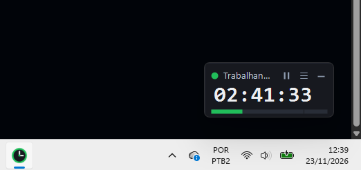 | 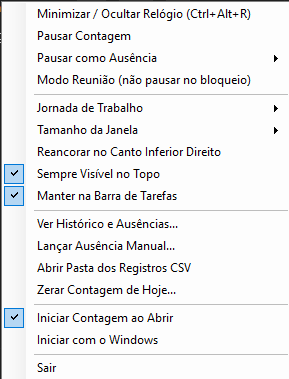 |

| Perfis de Jornada (8h +2h extras / Estagiário 6h) | Pausa rápida por tipo de ausência |
| :---: | :---: |
| 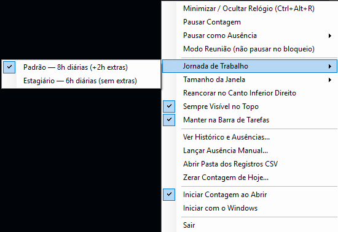 | 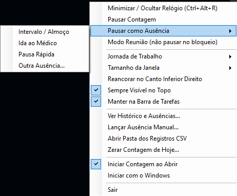 |

### Alertas de Jornada e Hora Extra

| Pré-aviso de 15 min (07:45) | Mini-widget em pré-aviso (`Quase 8h`) |
| :---: | :---: |
| 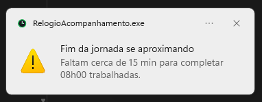 | 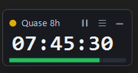 |

| Jornada de 8h concluída (início de hora extra) | Mini-widget em Hora Extra (borda e indicador laranja) |
| :---: | :---: |
| 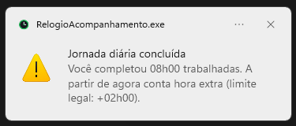 | 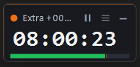 |

### Controle de Ausências / Intervalos, Sessões e Registros Diários

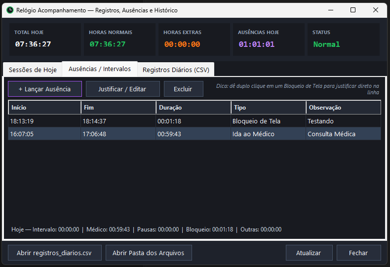

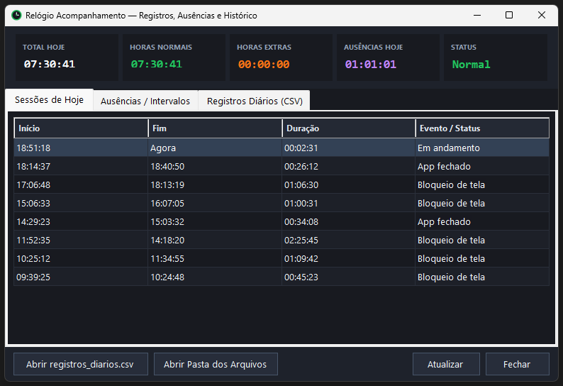

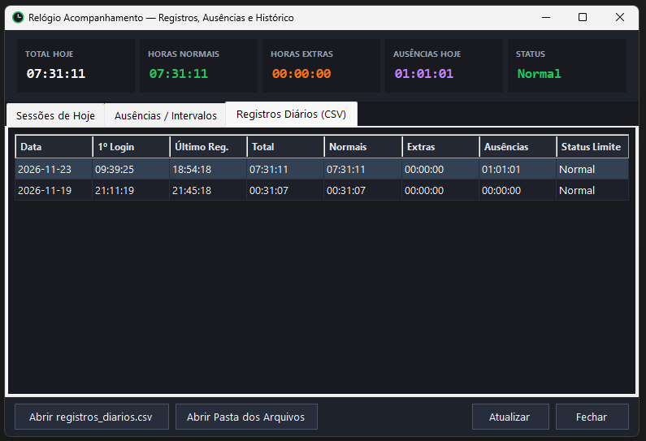

## Recursos

- **Pergunta ao abrir (Trabalho vs. Uso Pessoal / Hobby / Curso)**:
  - Ao iniciar, o aplicativo pergunta se você está começando o expediente ou acessando para uso pessoal (estudos, hobby, curso, fim de semana). No **Modo Uso Pessoal**, nenhuma hora trabalhada ou ausência é gerada — e você pode alternar para trabalho a qualquer momento.
- **Contagem real e Modo Reunião**:
  - Congela automaticamente ao bloquear a tela (`Win + L` ou bloqueio automático do Windows), deslogar, suspender/hibernar ou desligar, e retoma ao voltar.
  - **Modo Reunião (não pausar no bloqueio)**: ao ativar no menu de clique direito, você pode bloquear a tela para ir a uma sala de reunião sem congelar a contagem e sem registrar ausência.
- **Registro de Ausências e Intervalos (com sobrescrita automática)**:
  - Registra automaticamente o tempo ausente em bloqueios de tela e pausas rápidas, além de permitir **Pausar como Ausência** (*Intervalo / Almoço*, *Ida ao Médico*, *Pausa Rápida*, *Outra Ausência*) ou **Lançar Ausência Manual** com horário de início/fim e observação.
  - Ao lançar uma ausência manual num período (ex.: `08:00–11:50`), qualquer bloqueio de tela ou sessão registrada dentro daquele intervalo é **sobrescrita automaticamente** para refletir a jornada real.
  - **Ida ao Médico** já vem marcada como **Abona BH** por padrão (ausência legal que não desconta no Banco de Horas).
- **Banco de Horas (Semanal, Mensal e Semestral — jornada 8h CLT)**:
  - Nova aba **Banco de Horas** exibindo **Saldo** e **A compensar** para:
    - **Semanal** (segunda a sexta)
    - **Mensal (Competência)**: corte do **dia 11 ao dia 10** do mês seguinte (ex.: `11/11` a `10/12`, iniciando em `23/11/2026`)
    - **Ciclo Semestral (6 meses, zera e recomeça)**: **Ciclo 1** (`11/01` a `10/07`) e **Ciclo 2** (`11/07` a `10/01`)
  - **Tolerância diária de ±15 minutos (padrão CLT)**: diferenças de até 15 min ficam zeradas; acima de 15 min conta a diferença inteira.
  - **Dias úteis sem registro** (Seg–Sex): descontam `-08:00` e ficam sinalizados em destaque para você apontar o motivo com 1 clique (*Feriado*, *Atestado*, *Abonado Total*, *Abonado Parcial 4h*, *Imprensado Abonado ou -8h*, *Desconto Confirmado / Folga BH*, *Esqueci de abrir o app* informando horas trabalhadas, ou *Outra Situação*).
  - **Radar de Padrões & Simulador de Fechamento (100% C# puro)**: painel integrado na aba *Banco de Horas* (ativado automaticamente a partir de 10 dias úteis registrados) que calcula perfil por dia da semana (mediana de entrada/saída, Média Móvel Exponencial de saldo e volatilidade), projeta o fechamento do ciclo em 3 cenários (*Realista*, *Conservador* e *Meta semanal para zerar*, já descontando feriados cadastrados) e sugere os dias mais estáveis da semana para compensar horas.
- **Bem-Estar e Lembretes Contextuais** *(menu → Bem-Estar e Lembretes...)*:
  - Lembrete periódico de hidratação/alongamento (`30`, `45` ou `60 min`) contado **apenas em tempo ativo**, zerando sozinho após qualquer pausa ou bloqueio ≥ 5 min e segurando avisos durante o **Modo Reunião** e **Uso Pessoal** (com opção de silenciar pelo resto do dia).
  - **Alertas preventivos de fadiga** (após `19h30`, 2+ dias seguidos de hora extra ou 2+ dias saindo após `20h`) e **aviso de 07h45 enriquecido** com o saldo acumulado da semana.
- **Pausa manual e início opcional**:
  - Botão `⏸ / ▶` direto no widget (e no menu da bandeja) para saídas rápidas sem bloquear o PC. Não pausa por mouse parado (ideal para reuniões, palestras e treinamentos).
  - No menu de clique direito, você pode marcar/desmarcar **Iniciar Contagem ao Abrir** (se desmarcar, o app abre pausado esperando você clicar em `▶`).
  - Também há a opção **Zerar Contagem de Hoje...** no menu de clique direito caso precise limpar testes do dia atual.
- **Mini-widget ajustável**: inicia no canto inferior direito, sempre visível (configurável), arrastável, redimensionável pelas bordas ou via presets (*Compacto*, *Padrão*, *Grande*).
- **Minimizar / Visualizar na Barra de Tarefas**:
  - Por padrão, o ícone fica **fixo na Barra de Tarefas** mesmo quando você minimiza (`—`), permitindo clicar no ícone para abrir/minimizar novamente em 1 clique.
  - Passar o mouse sobre o botão na barra de tarefas (ou no ícone da bandeja) mostra o tempo trabalhado ao vivo mesmo minimizado.
  - Atalho global **`Ctrl + Alt + R`** também alterna a janela a qualquer momento.
  - Se preferir ocultar até da barra de tarefas (ficando só na bandeja ao lado do relógio), desmarque **Manter na Barra de Tarefas** no menu de clique direito.
- **Perfis de Jornada e Alertas Legais** *(selecionável em Jornada de Trabalho no menu)*:
  - **Padrão — 8h diárias (+2h extras)** *(padrão)*: alertas em `07:45`, `08:00` (início extra), `09:45` e `10:00` (limite legal).
  - **Estagiário — 6h diárias (sem extras)**: pré-aviso em `05:45` e alerta crítico de limite legal em `06:00`, sem acúmulo de horas extras.
- **Registros em CSV simples** (salvos em `%LOCALAPPDATA%\RelogioAcompanhamento\`):
  - `registros_diarios.csv` — resumo de cada dia com horas trabalhadas, extras e total de ausências (abre direto no Excel)
  - `sessoes_YYYY-MM.csv` — detalhamento de todos os intervalos trabalhados do mês
  - `ausencias_YYYY-MM.csv` — histórico detalhado de intervalos, idas ao médico (com coluna `Abonado`), pausas e bloqueios de tela
  - `dias_especiais.csv` — apontamentos do Banco de Horas (feriados, atestados, abonos, imprensados, esquecimentos)
  - `config.ini` — perfil de jornada, data inicial do BH, tamanho, posição e preferências

## Tecnologias utilizadas e o porquê

Este projeto foi construído priorizando **leveza máxima, simplicidade e zero dependências externas**.

| Camada | Tecnologia | Por que foi escolhida |
| :--- | :--- | :--- |
| **Linguagem** | **C#** (compilado via `csc.exe` nativo do Windows) | Linguagem fortemente tipada, rápida e com integração direta ao ecossistema Windows. |
| **Plataforma / Runtime** | **.NET Framework 4.8** (já embutido no Windows 10/11) | Sim, o projeto usa **.NET** — especificamente o .NET Framework 4.8 que já vem instalado nativamente no Windows. Isso evita baixar SDKs ou runtimes extras e gera um único executável de **~62 KB** que consome apenas **~10–15 MB de RAM**. |
| **Interface Gráfica (UI)** | **Windows Forms (WinForms) + GDI+** (`System.Windows.Forms`, `System.Drawing`) | Muito mais leve que frameworks baseados em navegador (como Electron). O desenho customizado em GDI+ permite redimensionar o mini-widget livremente com escala proporcional das fontes e sem cortes em telas com zoom (DPI). |
| **Integração com o Windows** | **SystemEvents** (`Microsoft.Win32`) + **Win32 API (P/Invoke)** | `SystemEvents` captura com precisão eventos reais do sistema operacional (bloqueio `Win + L`, bloqueio automático, logoff, suspensão e desligamento). Win32 (`user32.dll` / `dwmapi.dll`) fornece atalho global (`Ctrl + Alt + R`), cantos arredondados no Windows 11, arraste/redimensionamento sem bordas e instância única. |
| **Armazenamento** | **Arquivos CSV + INI** (UTF-8 com BOM, separador `;`) | Formato mais simples e leve possível: dispensa banco de dados externo (como SQLite), não exige DLLs adicionais e pode ser aberto diretamente no Excel ou Bloco de Notas. |
| **Build e Testes** | **PowerShell** (`build.ps1`, `run-tests.ps1`) + testes unitários em C# puro | Compila o projeto e gera o ícone `.ico` em menos de 1 segundo usando apenas ferramentas nativas do Windows, além de rodar a suíte de testes sem frameworks externos. |

### C# e .NET são coisas diferentes?

Sim — eles trabalham juntos:
- **C#** é a **linguagem de programação** usada para escrever o código-fonte (arquivos `.cs` em `src/`).
- **.NET** (neste projeto, o **.NET Framework 4.8**) é a **plataforma/runtime** que fornece o compilador (`csc.exe`), as bibliotecas padrão do Windows (janelas, gráficos, eventos de sessão, registro) e o ambiente que executa o `RelogioAcompanhamento.exe`.

> **Por que não usar Electron, Python ou .NET 8?**
> - **Electron** empacota um navegador Chromium inteiro (~100–150 MB de RAM e executável de dezenas de MB) — pesado demais para um relógio que fica aberto o dia todo.
> - **Python** exigiria instalar o interpretador ou empacotar um `.exe` grande (~50–80 MB) e depender de bibliotecas extras (`pywin32`) para eventos de bloqueio do Windows.
> - **.NET 8** exigiria baixar e instalar o SDK separadamente (ou embutir ~60 MB de runtime no `.exe`). Com o **.NET Framework 4.8** nativo do Windows, o resultado final tem **62 KB** e funciona imediatamente.

## Como compilar e testar

```powershell
# Compilar o executável único em dist\RelogioAcompanhamento.exe
.\build.ps1

# Rodar os testes unitários
.\run-tests.ps1

# Testar alertas em modo rápido (1 min normal + 30s extra, sem alterar seus dados reais)
.\dist\RelogioAcompanhamento.exe --demo-limits
```
